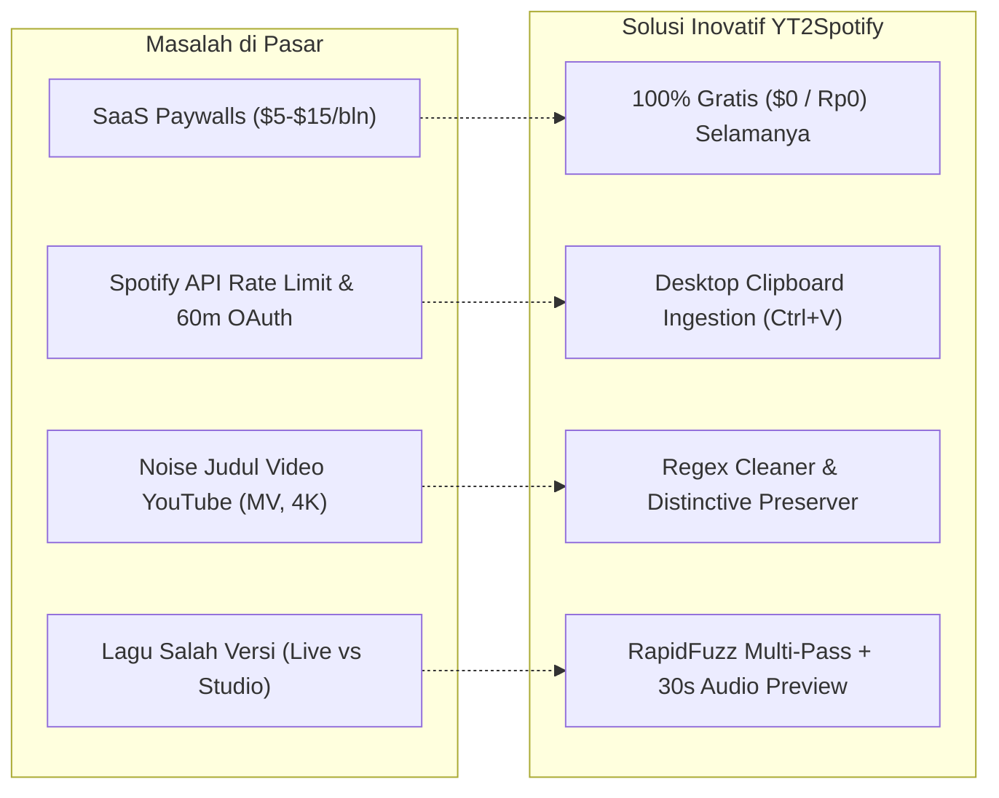

# 📑 PROJECT MASTER DOCUMENTATION (SSOT)
# YT2Spotify (`yt2sp`) — High-Precision, Zero-Cost Music Migration Platform

> **Status Proyek:** Production Stable (`v1.3.7`)  
> **Lisensi:** Custom Source License (Non-Commercial with Conditional Commercial Window)  
> **Klasifikasi:** Single Source of Truth (SSOT) Technical & Product Architecture  
> **Tanggal Rilis Dokumentasi:** 17 November 2026  

---

## 1. Peta Navigasi Dokumentasi Lengkap (Documentation Index)

Dokumentasi teknis dan arsitektur produk ini telah disusun secara modular ke dalam direktori [documentation/](file:///C:/Users/Elang/.gemini/antigravity/worktrees/yt-spt/generate_technical_documentation/documentation/) untuk memudahkan pembelajaran manusia maupun pemrosesan oleh model AI:

| Nomor Dokumen | Nama Berkas & Tautan | Cakupan & Fokus Bahasan |
| :---: | :--- | :--- |
| **00** | [00_PROJECT_OVERVIEW.md](file:///C:/Users/Elang/.gemini/antigravity/worktrees/yt-spt/generate_technical_documentation/documentation/00_PROJECT_OVERVIEW.md) | **Ringkasan Eksekutif & Orientasi:** Identitas proyek, metadata, nilai inti, filosofi desain, dan panduan konsumsi AI. |
| **01** | [01_PRD.md](file:///C:/Users/Elang/.gemini/antigravity/worktrees/yt-spt/generate_technical_documentation/documentation/01_PRD.md) | **Product Requirements Document (PRD):** Visi produk, problem statement, persona pengguna, USP, 8 Functional Requirements terperinci, NFR, User Stories, & Use Cases. |
| **02** | [02_SRS.md](file:///C:/Users/Elang/.gemini/antigravity/worktrees/yt-spt/generate_technical_documentation/documentation/02_SRS.md) | **System & Software Requirements Specification (SRS):** Batasan sistem, inventaris teknologi lengkap (Python, JS, Tailwind, SQLite WAL), API catalog overview, & spesifikasi keamanan anti-CSRF. |
| **03** | [03_SYSTEM_ARCHITECTURE.md](file:///C:/Users/Elang/.gemini/antigravity/worktrees/yt-spt/generate_technical_documentation/documentation/03_SYSTEM_ARCHITECTURE.md) | **System Architecture & Topology:** Diagram Arsitektur Tingkat Tinggi (Mermaid), Diagram Komponen, Diagram Alur Data (DFD) End-to-End, & Diagram Topologi Deployment Lokal. |
| **04** | [04_UI_UX_SPECIFICATION.md](file:///C:/Users/Elang/.gemini/antigravity/worktrees/yt-spt/generate_technical_documentation/documentation/04_UI_UX_SPECIFICATION.md) | **UI/UX & Design Specification:** Sistem Desain editorial *Transactify*, palet token CSS, tipografi Newsreader, Potato Mode (GPU Saver), spesifikasi 7 Views, 7 Modal dialogs, & Mermaid UX Flow. |
| **05** | [05_SOURCE_CODE_DOCUMENTATION.md](file:///C:/Users/Elang/.gemini/antigravity/worktrees/yt-spt/generate_technical_documentation/documentation/05_SOURCE_CODE_DOCUMENTATION.md) | **Source Code & Module Deep-Dive:** Struktur direktori aktual, penelusuran berkas per berkas (14 file Python, JS, HTML), signature fungsi, konstanta, & pola singleton client. |
| **06** | [06_BUSINESS_LOGIC_AND_ALGORITHMS.md](file:///C:/Users/Elang/.gemini/antigravity/worktrees/yt-spt/generate_technical_documentation/documentation/06_BUSINESS_LOGIC_AND_ALGORITHMS.md) | **Business Logic, Algorithms & State:** Formula skor RapidFuzz, penalti durasi & penanda pembeda, token bucket rate limiter, hierarki validasi genre 5 level, parser AI multibahasa, & lifecycle aplikasi. |
| **07** | [07_DATABASE_AND_API_SPECIFICATION.md](file:///C:/Users/Elang/.gemini/antigravity/worktrees/yt-spt/generate_technical_documentation/documentation/07_DATABASE_AND_API_SPECIFICATION.md) | **Database & REST API Specification:** Skema relasional SQLite WAL, DDL 7 tabel & 7 indeks, Mermaid ERD, serta spesifikasi lengkap 12 endpoint REST API beserta contoh request/response JSON. |
| **08** | [08_TESTING_AND_QA.md](file:///C:/Users/Elang/.gemini/antigravity/worktrees/yt-spt/generate_technical_documentation/documentation/08_TESTING_AND_QA.md) | **Testing & Quality Assurance:** Audit hasil eksekusi Pytest (19 Passed, 2 Failed), matriks 21 test case otomatis, dan Root Cause Analysis (RCA) kegagalan pengujian ambang batas di `test_score.py`. |
| **09** | [09_DEVELOPMENT_AND_OPERATIONS.md](file:///C:/Users/Elang/.gemini/antigravity/worktrees/yt-spt/generate_technical_documentation/documentation/09_DEVELOPMENT_AND_OPERATIONS.md) | **Development & Operations Runbook:** Panduan instalasi lokal, 13 sub-perintah CLI Typer, troubleshooting matrix masalah umum, dan Feature Dependency Impact Matrix untuk developer/AI. |
| **10** | [10_KNOWN_ISSUES_AND_ROADMAP.md](file:///C:/Users/Elang/.gemini/antigravity/worktrees/yt-spt/generate_technical_documentation/documentation/10_KNOWN_ISSUES_AND_ROADMAP.md) | **Known Issues, Technical Debt & Roadmap:** Matriks status implementasi fitur, daftar utang teknis terprioritaskan (Critical/High/Med/Low), dan peta jalan rilis terstruktur (v1.3.8 s/d v2.0.0). |

---

## 2. Gambaran Ringkas Sistem & Nilai Terobosan

YT2Spotify (`yt2sp`) memecahkan kendala migrasi playlist musik antarlayanan dengan 4 terobosan teknis utama:



1. **Injeksi Clipboard Desktop (`Ctrl + V`):**
   Alih-alih membuat playlist melalui panggilan REST API Spotify yang lambat dan dibatasi kuota developer yang ketat, `yt2sp` memanfaatkan mekanisme internal aplikasi **Spotify Desktop Client**. Pengguna cukup mengklik tombol "Salin Semua URI Spotify" atau menyalin per blok 50 lagu, lalu menekan **`Ctrl + V`** (atau **`Cmd + V`** di macOS) langsung di playlist kosong Spotify Desktop. Seluruh lagu masuk secara instan tanpa melalui kuota Web API.
2. **Mesin Rekonsiliasi Bertingkat (Multi-Pass Matching Engine):**
   - **Tier 1:** Pencarian langsung ke katalog internal Spotify via `spotifyscraper` tanpa token developer, dievaluasi menggunakan algoritma *Token Set Ratio* RapidFuzz (C++ bindings), penalti durasi, dan penalti penanda pembeda aransemen.
   - **Tier 2 (Fallback):** Jika Tier 1 gagal, sistem mencari metadata di Deezer Public API untuk mengambil kode **ISRC (International Standard Recording Code)** internasional, kemudian memetakan kode ISRC tersebut ke Spotify ID melalui MusicBrainz API atau kueri Spotify native `isrc:<ISRC>`.
3. **Dual-Provider Audio Preview (Chorus / Reff):**
   Pengguna dapat mendengarkan pratinjau audio 30 detik pada bagian chorus/reff hanya dengan mengarahkan kursor (*hover*) ke cover lagu di Review Studio. Menggunakan kaskade otomatis (Deezer CDN MP3 $\rightarrow$ Apple iTunes API AAC) dengan in-memory cache 24 jam.
4. **Validasi Silang Genre Multi-Sumber:**
   Mengklasifikasikan lagu ke dalam 14 kelompok genre terstandarisasi dengan memvalidasi kesepakatan antara Apple iTunes Search API dan Deezer Album Genre API secara paralel ($\le 4$ detik), dilengkapi fallback heuristik cerdas untuk OST Game, Anime/Vocaloid, Dangdut, dan Lofi.
5. **Smart Group Playlist Builder & AI Prompt Studio:**
   Menyediakan studio pembuat prompt terstruktur untuk AI (ChatGPT/Claude/Gemini) dan parser teks cerdas yang kebal format untuk mengelompokkan lagu berdasarkan mood, genre, atau era secara otomatis ke dalam playlist kustom baru.

---

## 3. Matriks Arsitektur Modul Kode Sumber

```
yt2sp (Package Root)
 ├── cli.py                     # Typer CLI Entrypoint (13 Commands)
 ├── config.py                  # TOML Config Parser & Deep Merge
 ├── ytm/                       # Ingestion Layer
 │    └── extract.py            # YTM API Client, Regex URL Cleaner, Unavailable Counter
 ├── match/                     # Normalization & Fuzzy Math
 │    ├── normalize.py          # 17 Noise Patterns Stripper, 15 Distinctive Markers Preserver
 │    └── score.py              # RapidFuzz Scorer, Duration & Marker Penalty Math
 ├── resolve/                   # Reconciliation & Classification
 │    ├── rate_limiter.py       # Thread-Safe Token Bucket & Exponential Backoff
 │    ├── spotify_resolver.py   # Public Spotify Catalog Scraper & Alternative Versions Finder
 │    ├── deezer_resolver.py    # Deezer Search, ISRC Extractor & MusicBrainz Bridge
 │    ├── genre.py              # Parallel Cross-Validated Genre Engine (iTunes + Deezer)
 │    └── pipeline.py           # Resolution Orchestrator with Cancellation Support
 ├── store/                     # Persistence Layer
 │    └── db.py                 # SQLite 3 WAL Mode, 6 PRAGMAs, DDL & Cascade Deletions
 ├── export/                    # Presentation Dispatch
 │    ├── writer.py             # 50-Song URI Block Text Writer & Validator
 │    └── report.py             # UTF-8 BOM CSV Auditor with Web Search Links
 └── ui/                        # Web Dashboard Presentation
      ├── server.py             # ThreadingHTTPServer, REST API, Anti-CSRF, ETag, Gzip
      ├── index.html            # Editorial SPA (Newsreader, Plus Jakarta Sans, Tailwind)
      ├── i18n.js               # 6 Languages Dictionary (ID, EN, ES, JA, KO, ZH)
      └── assets/               # Local Demo Artwork Assets
```

---

## 4. Panduan Eksekusi untuk AI & Agen Pengembang

Jika kamu adalah sistem AI yang bertugas melanjutkan pengembangan, memperbaiki bug, atau melakukan refactoring pada repositori ini:

1. **Perhatikan Temuan Kegagalan Uji pada `tests/test_score.py`:**
   - **Status Saat Ini:** 19 Passed, 2 Failed.
   - **Akar Masalah:** Commit `940a18e` menurunkan nilai penalti pembeda dari `0.30` ke `0.12` dan menurunkan `auto_accept_threshold` dari `0.85` ke `0.80`. Kode pengujian belum diselaraskan.
   - **Tindakan yang Disarankan:** Baca detail lengkap di [08_TESTING_AND_QA.md](file:///C:/Users/Elang/.gemini/antigravity/worktrees/yt-spt/generate_technical_documentation/documentation/08_TESTING_AND_QA.md) sebelum memodifikasi logika scoring.
2. **Koneksi SQLite Menggunakan Thread-Local:**
   - Jangan membagikan instance objek koneksi SQLite antar thread. Selalu gunakan `db._get_conn()` di dalam thread yang bersangkutan untuk mendapatkan koneksi lokal dengan konfigurasi PRAGMA WAL mode.
3. **Format URI Clipboard Harus Bersih:**
   - Aplikasi Spotify Desktop sangat sensitif terhadap karakter komentar. Baris teks yang disalin ke clipboard sistem operasi harus murni berupa baris `spotify:track:<22_char_id>` tanpa tanda `# Header` atau teks markdown lainnya.
4. **Keamanan Cross-Origin (CSRF):**
   - Setiap endpoint POST di `server.py` dilindungi oleh `_is_safe_origin()`. Pengujian otomatis via HTTP client lokal harus menyertakan header `Origin: http://127.0.0.1:5000` atau tanpa header Origin (direct request).

---

*Dokumen master ini berfungsi sebagai indeks utama dan portal gerbang menuju seluruh detail teknis pada suite dokumentasi YT2Spotify (`yt2sp`).*
