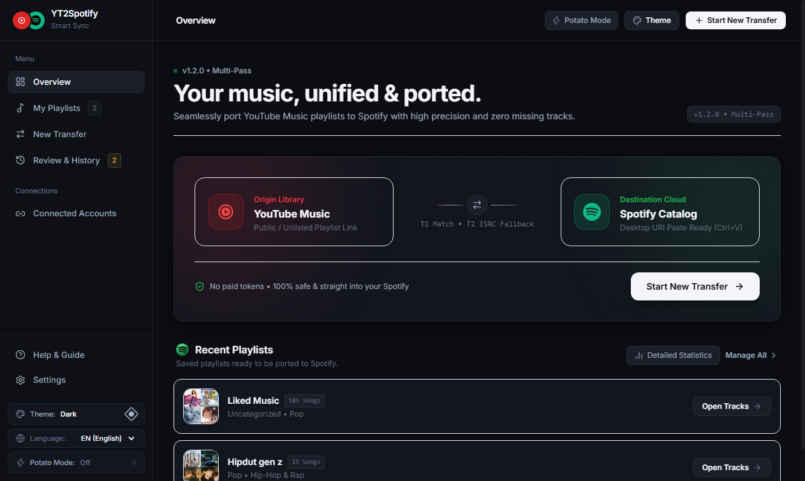
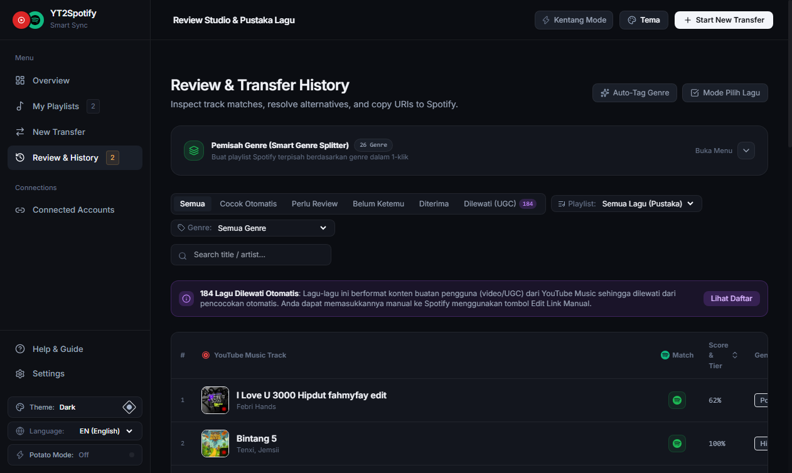
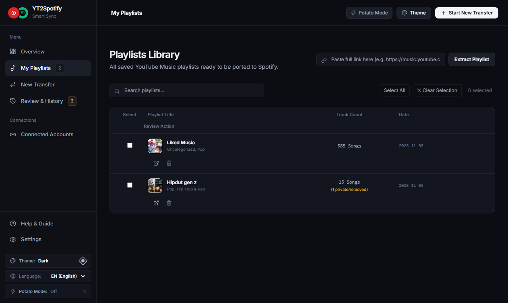
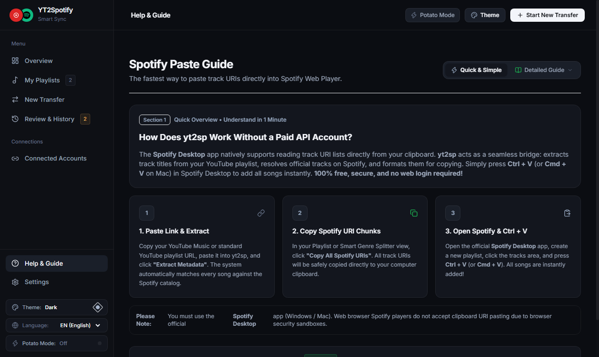

# YT2Spotify (yt2sp)

> **Seamlessly port YouTube Music playlists to Spotify — 100% Free, Zero API Costs, & Zero Missing Tracks.**

**YT2Spotify** is a fast, privacy-focused, zero-cost desktop migration tool designed to accurately transfer music collections from YouTube Music to Spotify without paying for third-party subscription services or requiring expensive Spotify Developer API credentials.

---

## Interface Previews

### 1. Dashboard & Multi-Pass Sync Overview
A clean, minimal home view displaying local library status, recently extracted playlists with vinyl-style cards, and quick actions to start new transfers.



---

### 2. Review Studio, Match Scoring, & Smart Genre Splitter
Audit match precision with percentage confidence scores, hover over any thumbnail to stream instant 30-second audio previews (chorus/reff), filter out non-music UGC videos, and split collections into standalone genre playlists with a single click.



---

### 3. Playlists Library & Batch Operations
Manage all archived YouTube Music playlists, inspect track lists, select multiple tracks, and delete unwanted entries directly.



---

### 4. Guided Workflow & Integrated Paste Guide
A concise 3-step guide for everyday users, featuring an interactive chevron expander to reveal deep-dive technical steps (Phases A through E) and troubleshooting instructions.



---

## Core Features

- **Zero-Cost Architecture ($0 / Rp0):** Direct catalog discovery without requiring Spotify Developer accounts, paid third-party tokens, or OAuth client secrets.
- **Smart Multi-Pass Matching Engine:**
  - **Aggressive Title Sanitization:** Automatically strips noise words like `[Official Video]`, `ft.`, `Remix`, `4K`, Japanese brackets `【...】`, and uploader channels.
  - **Fuzzy Levenshtein Distance:** Evaluates title and artist similarity using [RapidFuzz](https://github.com/rapidfuzz/RapidFuzz).
  - **Duration Tolerance Window ($\pm 10\%$):** Differentiates full-length original tracks from short video edits or extended remix compilations.
- **Instant Audio Preview Engine (Chorus / Reff):** Stream 30-second audio samples directly in the browser by hovering over song thumbnails, backed by a resilient dual-provider fallback architecture (Deezer + iTunes Search API).
- **Automated Smart Genre Tagging:** Rules-based and artist-matching genre categorizer to effortlessly organize diverse music libraries.
- **Modern Web UI & Powerful CLI:**
  - Responsive web dashboard with 4 handcrafted color schemes (*Modern Dark*, *Emerald Mint*, *Warm Amber*, *Slate Graphite*).
  - Built-in **Potato Mode** (performance toggle) to disable blur and heavy animations on budget hardware.
  - Multi-language support (English, Indonesian, Spanish, Japanese, Korean, Chinese).
- **100% Local Privacy:** All playlist history and SQLite databases remain strictly on your local machine. No tracking, telemetry, or external database storage.

---

## Installation

### Prerequisites
- Python 3.11 or later
- Any modern web browser (Chrome, Edge, Firefox, Brave)

### Setup Steps

1. **Clone the repository:**
   ```bash
   git clone https://github.com/ramaci-cmd/yt2spt.git
   cd yt2spt
   ```

2. **Create and activate a virtual environment:**
   ```bash
   # Windows (PowerShell)
   python -m venv .venv
   .\.venv\Scripts\Activate.ps1

   # Linux / macOS
   python3 -m venv .venv
   source .venv/bin/activate
   ```

3. **Install dependencies:**
   ```bash
   pip install -e .
   ```

---

## Usage

### 1. Web Dashboard (Recommended)

Start the local server:
```bash
python -m yt2sp.ui.server
```
Open your browser and navigate to: **`http://127.0.0.1:5000`**

#### Standard Workflow:
1. **Step 1 — Extract:** Paste a public or unlisted YouTube Music playlist URL, then click **Extract Metadata**.
2. **Step 2 — Review:** Review match quality in the Review Studio. Hover over song thumbnails to hear the audio preview, pick alternative versions, or remove tracks.
3. **Step 3 — Copy & Paste to Spotify:** Copy the generated Spotify track URI chunks (50 URIs per batch) and press `Ctrl + V` (`Cmd + V` on macOS) directly inside a new playlist in Spotify Desktop.

---

### 2. Command-Line Interface (CLI)

```bash
# Extract a playlist from YouTube Music
yt2sp extract "https://music.youtube.com/playlist?list=..."

# Match tracks against the Spotify catalog
yt2sp match <playlist_id>

# Export matched Spotify URIs ready for pasting
yt2sp export <playlist_id>
```

---

## Testing

The test suite includes automated unit tests covering scoring, normalization, database persistence, and genre heuristics:
```bash
pytest
```

---

## License

This project is licensed under the [MIT License](LICENSE). Built for educational and personal music migration purposes.
