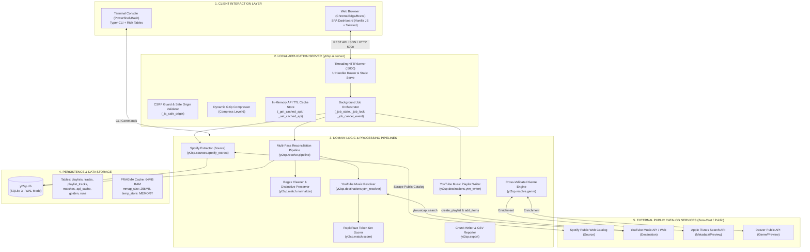
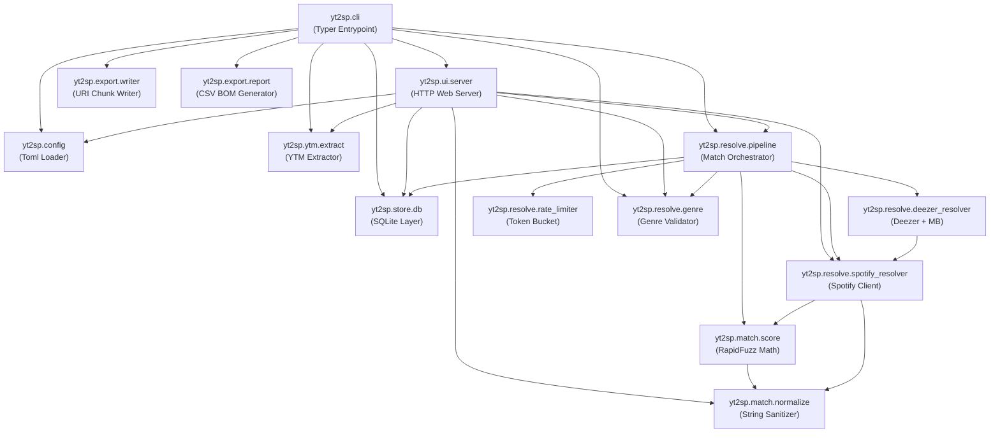
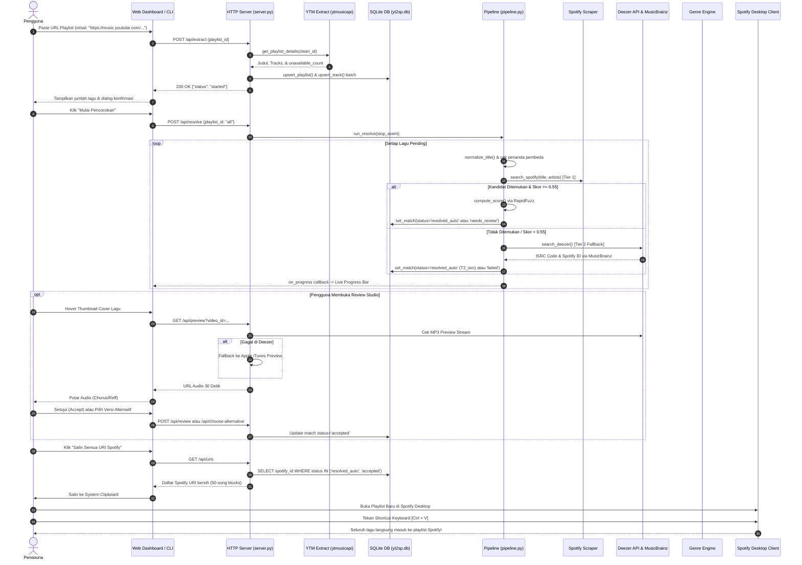

# 03. SYSTEM ARCHITECTURE & COMPONENT TOPOLOGY
# Spotify2YTM (`sp2yt` / `yt2sp` v2.0.0) — High-Precision Reverse Migration Platform (Spotify → YouTube Music)

---

## 1. Architectural Patterns & Design Principles

Spotify2YTM mengadopsi kombinasi pola arsitektur modern yang disesuaikan untuk keandalan eksekusi lokal dan migrasi arah baru:

1. **Local-First & Offline-Ready Architecture:** Seluruh data master, status relasi, dan cache respon API disimpan dalam satu file database lokal (`yt2sp.db`). Pengguna tetap dapat meninjau, memfilter, dan mengelola playlist yang sudah dicocokkan meskipun koneksi internet terputus.
2. **Layered Pipeline Architecture (ETL Pattern):** Alur kerja sistem terpisah secara tegas ke dalam 5 lapisan independen:
   - *Ingestion Layer:* Ekstraksi dari sumber **Spotify** (`yt2sp.sources.spotify_extract`).
   - *Persistence Layer:* Penyimpanan dan indexing SQLite 3 WAL dengan skema provider-neutral.
   - *Reconciliation & Matching Engine:* Normalisasi, fuzzy distance RapidFuzz, dan pencarian katalog tujuan **YouTube Music** (`yt2sp.destinations.ytm_resolver`).
   - *Classification & Enrichment Layer:* Validasi silang genre multi-sumber (iTunes + Deezer).
   - *Destination Dispatch & Writing Layer:* Pembuatan dan injeksi playlist otomatis ke akun **YouTube Music** (`yt2sp.destinations.ytm_writer`), dengan cadangan ekspor CSV.
3. **Decoupled Asynchronous Background Worker Pattern:** Seluruh operasi I/O jaringan yang membutuhkan waktu lama (ekstraksi, pencocokan massal, validasi genre, pembuatan playlist YTM) dieksekusi di *daemon thread* terpisah (`threading.Thread(target=..., daemon=True)`), sementara thread utama server HTTP tetap melayani request UI secara non-blocking dengan polling adaptif.
4. **Resilient Multi-Pass Fallback Pattern:** Pencarian lagu di YouTube Music mendahulukan katalog lagu resmi (`filter='songs'`), lalu fallback ke katalog video resmi jika lagu belum ditemukan.
5. **Batch Playlist Population with Chunking:** Injeksi lagu ke playlist YouTube Music dipecah ke dalam chunk aman berisi 50 video ID untuk mencegah timeout dan rate limiting.

---

## 2. High-Level System Architecture Diagram

Diagram berikut mengilustrasikan arsitektur sistem tingkat tinggi dari antarmuka pengguna hingga integrasi pihak ketiga eksternal.


        EXT_SPOTIFY["Spotify Web Public Catalog<br/>(via spotifyscraper & oEmbed)"]
        EXT_DEEZER["Deezer Public Search & Track API<br/>(ISRC & 30s Audio Stream)"]
        EXT_MUSICBRAINZ["MusicBrainz Open Metadata<br/>(/ws/2/isrc -> Spotify Track URL)"]
        EXT_ITUNES["Apple iTunes Search API<br/>(Genre & 30s Audio Fallback)"]
    end

    %% Relasi Client ke Server
    BROWSER <-->|REST JSON & SSE/Polling| HTTP_ROUTER
    TERMINAL <-->|Direct Subprocess Call| PIPELINE_LAYER
    HTTP_ROUTER --> AUTH_GUARD --> GZIP_ENGINE
    GZIP_ENGINE --> API_CACHE
    API_CACHE <--> JOB_ORCHESTRATOR

    %% Relasi Server ke Pipeline
    JOB_ORCHESTRATOR -->|Spawns Worker Thread| YTM_EXTRACTOR
    JOB_ORCHESTRATOR -->|Spawns Worker Thread| MATCH_PIPELINE
    JOB_ORCHESTRATOR -->|Spawns Worker Thread| GENRE_VALIDATOR

    %% Relasi Pipeline
    YTM_EXTRACTOR --> PERSISTENCE_LAYER
    MATCH_PIPELINE --> NORMALIZER --> SCORING_ENGINE
    MATCH_PIPELINE --> RATE_LIMITER
    MATCH_PIPELINE <--> PERSISTENCE_LAYER
    GENRE_VALIDATOR <--> PERSISTENCE_LAYER
    EXPORT_ENGINE <--> PERSISTENCE_LAYER

    %% Relasi ke Eksternal
    YTM_EXTRACTOR <-->|HTTPS| EXT_YTM
    RATE_LIMITER --> EXT_SPOTIFY
    MATCH_PIPELINE <-->|Tier 1 Scraping| EXT_SPOTIFY
    MATCH_PIPELINE <-->|Tier 2 ISRC Fallback| EXT_DEEZER
    EXT_DEEZER <-->|ISRC Lookup| EXT_MUSICBRAINZ
    GENRE_VALIDATOR <-->|Parallel Query| EXT_ITUNES
    GENRE_VALIDATOR <-->|Parallel Query| EXT_DEEZER
    HTTP_ROUTER <-->|Audio Preview Proxy| EXT_DEEZER
    HTTP_ROUTER <-->|Audio Preview Fallback| EXT_ITUNES

    %% Ekspor ke Spotify Desktop
    EXPORT_ENGINE -->|System Clipboard / Chunk File| SPOTIFY_DESKTOP
    SPOTIFY_DESKTOP -->|Ctrl + V Keyboard Ingestion| SPOTIFY_DESKTOP
```

---

## 3. Component Diagram & Module Dependencies

Diagram dependensi modul di bawah ini memetakan interaksi antar-modul Python dalam paket `yt2sp`:



---

## 4. End-to-End Data Flow Diagram (DFD)

Alur transformasi data dimulai dari penarikan URL YouTube Music hingga penyalinan ke Spotify Desktop:



---

## 5. Deployment & Runtime Topology Diagram

Topologi eksekusi sistem pada lingkungan lokal komputer pengguna:

```mermaid
flowchart LR
    subgraph OS_ENVIRONMENT["KOMPUTER PENGGUNA (Windows / macOS / Linux)"]
        subgraph USER_SPACE["User Space Processes"]
            subgraph PYTHON_PROCESS["Python 3.11+ Process (yt2sp ui)"]
                MAIN_THREAD["Main Thread:<br/>ThreadingHTTPServer (127.0.0.1:5000)"]
                WORKER_1["Background Thread:<br/>Extraction / Matching / Genre Worker"]
                CONN_POOL["Thread-Local DB Connections<br/>(_local.conn)"]
            end
            
            subgraph BROWSER_PROCESS["Web Browser Instance"]
                SPA_TAB["Tab: http://127.0.0.1:5000<br/>Single Page App (DOM, Canvas, Web Audio)"]
            end

            subgraph SPOTIFY_PROCESS["Spotify Desktop App"]
                CLIPBOARD_LISTENER["Clipboard Buffer Ingestion<br/>Native Ctrl+V Hook"]
            end

            subgraph FILESYSTEM["Local File System"]
                DB_FILE["yt2sp.db (SQLite Database)"]
                WAL_FILE["yt2sp.db-wal (Write-Ahead Log)"]
                CONFIG_FILE["config.toml (User Configurations)"]
                OUTPUT_DIR["output/<br/>├── uris/ (*_part001.txt)<br/>└── reports/ (*_report.csv)"]
            end
        end
    end

    SPA_TAB <-->|Loopback HTTP Socket (127.0.0.1)| MAIN_THREAD
    MAIN_THREAD <--> CONN_POOL
    WORKER_1 <--> CONN_POOL
    CONN_POOL <--> DB_FILE
    CONN_POOL <--> WAL_FILE
    PYTHON_PROCESS --> OUTPUT_DIR
    CONFIG_FILE --> PYTHON_PROCESS
    SPA_TAB -.->|Direct Copy| CLIPBOARD_LISTENER
```
