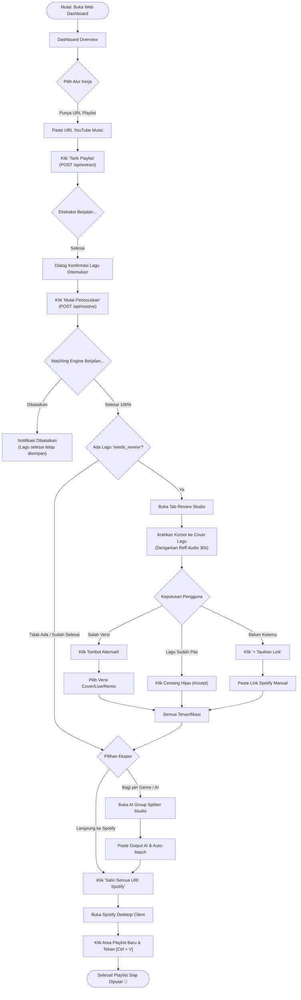

# 04. UI/UX & DESIGN SPECIFICATION
# YT2Spotify (`yt2sp`) — High-Precision, Zero-Cost Music Migration Platform

---

## 1. Design System & Visual Philosophy

Antarmuka web YT2Spotify dirancang dengan estetika editorial modern bernuansa *Warm Studio & Vintage Vinyl*, terinspirasi dari layout majalah desain *Transactify* dan antarmuka instrumen audio analog. Desain ini menghindari tampilan AI generik yang kaku dengan memprioritaskan tipografi bertingkat, kontras tinggi yang nyaman di mata, dan interaksi taktil seperti piringan hitam (*vinyl sleeve pull-out*).

### 1.1 Color Palette & Theme Tokens
Palet warna menggunakan variabel CSS global (`:root`) yang mendukung mode gelap (*dark mode*) sebagai tema bawaan:

| Token CSS | Kode Warna HEX / RGBA | Peruntukan Elemen Visual |
| :--- | :--- | :--- |
| `--bg-main` | `#0f1412` | Latar belakang aplikasi utama (Deep Forest Obsidian) |
| `--bg-card` | `#161c19` | Latar belakang kartu, panel modal, dan baris tabel |
| `--bg-hover` | `#1c2420` | State hover pada tombol dan baris daftar lagu |
| `--border-color` | `#232d28` | Garis batas (*subtle border*) pemisah konten |
| `--accent` | `#1db954` | Aksen hijau Spotify untuk tombol utama (*primary action*) dan badge status `resolved_auto` |
| `--accent-hover` | `#1ed760` | State hover aksen hijau Spotify |
| `--text-primary` | `#f0f4f2` | Teks judul utama dan kontras tertinggi |
| `--text-secondary`| `#9aa8a1` | Teks keterangan, nama artis, dan placeholder |
| `--badge-amber` | `#f59e0b` | Indikator status `needs_review` dan badge Prioritas Verifikasi |
| `--badge-purple`| `#a855f7` | Indikator versi aransemen alternatif (Cover/Remix/Live) |
| `--badge-blue` | `#3b82f6` | Indikator kemiripan judul tinggi |
| `--badge-red` | `#ef4444` | Indikator status gagal (`failed`) atau ditolak (`rejected`) |

### 1.2 Typography System
Sistem tipografi menggunakan perpaduan harmonis antara *Serif Editorial* untuk judul dan *Sans-Serif Geometris* untuk data teknis:
* **Display / Editorial Font:** *Newsreader* (Google Fonts) — Digunakan pada judul dashboard, kartu statistik utama, dan nama playlist untuk memberikan kesan koleksi musik fisik bergengsi.
* **Interface / Data Font:** *Plus Jakarta Sans* (Google Fonts) — Digunakan untuk seluruh navigasi, tabel katalog, badge status, tombol, dan log terminal.
* **Monospace Font:** *JetBrains Mono* / `font-mono` — Digunakan untuk Spotify URI, kode ISRC, JSON payload, dan angka durasi.

### 1.3 Potato Mode (Low-Spec Hardware Acceleration Toggle)
Untuk mengakomodasi pengguna dengan laptop berprosesor hemat daya atau grafis terintegrasi:
* Mengalihkan kelas CSS `.potato-mode` pada elemen `<body>`.
* **Atribut yang Dinonaktifkan:**
  - Efek blur latar belakang: `backdrop-filter: blur(...)` dinonaktifkan menjadi warna solid opak.
  - Bayangan berlapis: `box-shadow` dinonaktifkan.
  - Canvas wave visualizer: Gelombang animasi partikel dihentikan.
  - Shimmering skeleton animations: Disederhanakan menjadi warna datar.
* **Dampak:** Menurunkan konsumsi daya GPU hingga $90\%$ dan mencegah *frame drop*.

### 1.4 Internationalization (i18n) Engine
Implementasi bahasa instan pada berkas [yt2sp/ui/i18n.js](file:///C:/Users/Elang/.gemini/antigravity/worktrees/yt-spt/generate_technical_documentation/yt2sp/ui/i18n.js):
* Mendukung 6 bahasa: **Indonesian (`id`) - Default**, **English (`en`)**, **Spanish (`es`)**, **Japanese (`ja`)**, **Korean (`ko`)**, dan **Chinese (`zh`)**.
* Elemen DOM ditandai dengan atribut `data-i18n="KEY"`.
* Fungsi `setLanguage(lang)` memetakan terjemahan secara dinamis tanpa me-refresh halaman peramban.

---

## 2. Screen & Page Specification

Aplikasi dibangun sebagai Single Page Application (SPA) di [yt2sp/ui/index.html](file:///C:/Users/Elang/.gemini/antigravity/worktrees/yt-spt/generate_technical_documentation/yt2sp/ui/index.html), memiliki 7 tampilan utama (*views*) yang diaktifkan melalui fungsi `switchView(viewName)`:

```
[Sidebar Navigation]
  ├── Overview (view-overview)
  ├── Playlists Library (view-playlists)
  ├── Transfer Launchpad (view-transfer)
  ├── Review Studio & Tracks (view-history)
  ├── Accounts & Auth (view-accounts)
  ├── Paste Guide & Help (view-guide)
  └── Settings & Danger Zone (view-settings)
```

---

### View 1: `view-overview` — Command Center & Dashboard

```
+------------------------------------------------------------------------------------+
|  YT2Spotify Command Center                                 [Sync Status: Idle]     |
+------------------------------------------------------------------------------------+
|  [ STATS: Total: 1,250 | Cocok: 1,180 (94.4%) | Review: 42 | Gagal: 28 ]           |
+------------------------------------------------------------------------------------+
|  QUICK TRANSFER LAUNCHPAD                                                          |
|  [ Input: URL Playlist YouTube Music...                  ] [ Tarik & Cocokkan ]    |
+------------------------------------------------------------------------------------+
|  PLAYLIST TERBARU (Interactive Vinyl Cards)                                        |
|  +--------------------+  +--------------------+  +--------------------+            |
|  | [2x2 Art] [Vinyl]  |  | [2x2 Art] [Vinyl]  |  | [2x2 Art] [Vinyl]  |            |
|  | Japanese City Pop  |  | Indo Indie Folk    |  | Synthwave Chill    |            |
|  | 48 Lagu • 2 Del    |  | 85 Lagu • 0 Del    |  | 120 Lagu • 5 Del   |            |
|  +--------------------+  +--------------------+  +--------------------+            |
+------------------------------------------------------------------------------------+
```

* **Page ID:** `view-overview`
* **Tujuan:** Memberikan gambaran kesehatan pustaka, metrik sinkronisasi, peluncuran cepat, dan galeri playlist interaktif.
* **Komponen Visual Utama:**
  - **Banner Metrik:** Kartu ringkasan total lagu, rasio presisi otomatis (`resolved_auto`), jumlah lagu yang butuh review, dan jumlah lagu gagal.
  - **Quick Launchpad:** Form penarikan cepat URL YouTube Music dengan tombol satu langkah.
  - **Retro Vinyl Sleeve Cards:** Kartu playlist yang menampilkan 2x2 collage artwork, judul editorial serif, dan animasi piringan hitam vinyl yang bergeser keluar (*pull out*) saat kursor diarahkan ke kartu.
* **Empty State:** Menampilkan ilustrasi retro turntable dengan ajakan "Belum ada playlist yang ditarik. Tempelkan link playlist YouTube Music di atas untuk memulai!"
* **Loading State:** Bar notifikasi mengambang (*floating pill widget*) di pojok kanan bawah dengan progress bar persentase dan nama lagu yang sedang diproses.

---

### View 2: `view-playlists` — Playlists Library & 2x2 Collage Archive

* **Page ID:** `view-playlists`
* **Tujuan:** Mengelola dan mengarsipkan seluruh playlist yang telah ditarik ke database lokal.
* **Fitur & Interaksi:**
  - **Dynamic 2x2 Collage Artwork:** Merender 4 thumbnail video teratas dari YouTube CDN (`https://i.ytimg.com/vi/<vid>/mqdefault.jpg`) ke dalam grid 2x2 procedural.
  - **Indikator Video Tidak Tersedia:** Badge kuning (`unavailable_count`) yang memberitahu jika ada video yang telah dihapus oleh YouTube.
  - **Selection Mode:** Kemampuan memilih multi-playlist sekaligus untuk dihapus massal atau diekspor bersamaan.
  - **1-Click Salin URI Playlist:** Tombol salin instan seluruh URI yang terkandung dalam playlist tersebut.

---

### View 3: `view-transfer` — 4-Step Migration Wizard

* **Page ID:** `view-transfer`
* **Tujuan:** Memandu pengguna langkah demi langkah dalam proses migrasi berkapasitas besar.
* **Langkah-Langkah (4 Steps):**
  1. **Step 1 (Source Input):** Pengguna memasukkan link YouTube Music atau memilih opsi "Liked Music Pribadi".
  2. **Step 2 (Extraction & Audit):** Progress bar penarikan daftar lagu dari server YouTube; menampilkan deteksi lagu aktif vs video terhapus.
  3. **Step 3 (Configuration):** Penyesuaian ambang batas matching (*Auto-Accept Threshold*, *Review Threshold*) dan pemilihan playlist target.
  4. **Step 4 (Resolution Pipeline):** Visualisasi proses pencocokan langsung. Menyediakan tombol **"Batalkan"** (`POST /api/cancel`), status log terminal, dan tombol langsung ke Review Studio jika ada lagu yang meragukan.

---

### View 4: `view-history` — Review Studio & Track Library

* **Page ID:** `view-history`
* **Tujuan:** Pusat kendali verifikasi lagu, filter genre, audisi audio preview, dan pemisahan playlist berbasis AI.
* **Fitur & Interaksi:**
  - **Toolbar 3-Jalur:** Filter Status (*Semua, Cocok Otomatis, Perlu Review, Diterima, Ditolak, Gagal*), Filter Genre Dinamis, dan Kotak Pencarian Teks Bebas.
  - **Priority Highlighting on Needs Review:** Lagu-lagu yang belum diverifikasi dari builder atau berstatus `needs_review` otomatis muncul di baris paling atas dengan batas tepi amber menyala.
  - **Audio Preview on Hover:** Mengarahkan mouse ke cover lagu memicu pemutaran audio 30 detik (reff) dari Deezer/iTunes dengan indikator equalizer visual.
  - **Tombol Aksi per Baris:**
    * Tombol **Accept (Centang Hijau):** Menerima pasangan Spotify.
    * Tombol **Reject (Silang Merah):** Menolak pasangan Spotify.
    * Tombol **Alternatif (Ikon Disc Ungu):** Membuka modal versi alternatif (Cover, Live, Remix).
    * Tombol **Tautkan Link (Ikon Link Biru):** Membuka form cepat penautan link Spotify manual.
  - **AI Group Splitter Button:** Membuka modal studio untuk kurasi dan pengelompokan playlist tematik menggunakan kecerdasan buatan.

---

### View 5: `view-accounts` — Authentication & Platform Guide
* **Page ID:** `view-accounts`
* **Tujuan:** Panduan otentikasi YouTube Music (`ytm_auth.json`) untuk mengakses *Liked Songs* pribadi dan penjelasan mengapa akun Spotify Developer tidak diperlukan.

---

### View 6: `view-guide` — Spotify Desktop Paste Tutorial
* **Page ID:** `view-guide`
* **Tujuan:** Tutorial visual interaktif 4 langkah mengenai cara membuka Spotify Desktop, membuat playlist kosong, mengklik area track, dan menekan tombol shortcut keyboard `Ctrl + V`.

---

### View 7: `view-settings` — Preferences & Danger Zone
* **Page ID:** `view-settings`
* **Tujuan:** Mengatur parameter pencocokan global, mengaktifkan/menonaktifkan Potato Mode, memilih bahasa antarmuka, dan menyediakan tombol *Danger Zone* untuk mereset seluruh database lokal ke nol (`POST /api/reset`).

---

## 3. Modal Dialogs Specification

Aplikasi mengimplementasikan 7 modal dialog interaktif yang seluruhnya mendukung penutupan instan via tombol **`Escape` (Esc)** dan **klik latar belakang (*backdrop click*)**:

| Modal ID | Nama Modal | Fungsi & Tanggung Jawab |
| :--- | :--- | :--- |
| `modal-alternatives` | Alternative Picker | Menampilkan hingga 8 kandidat versi cover, live, remix, atau judul serupa dengan badge warna. |
| `modal-manual` | Manual Spotify Linker | Input field URL/URI Spotify dengan auto-fetch metadata judul dan thumbnail via oEmbed. |
| `modal-delete-track`| Track Deletion Modal | Konfirmasi penghapusan lagu dari playlist aktif atau penghapusan global dari seluruh library. |
| `modal-chunks` | 50-Song Chunks Modal | Menampilkan daftar blok 50 lagu dengan tombol salin per blok untuk playlist sangat besar. |
| `modal-stats` | Library Analytics | Menampilkan visualisasi persentase genre dan ringkasan metrik akurasi sistem. |
| `modal-copy-tracks` | AI Prompt Track Copier | Konfigurator prompt AI dengan preview cover lagu, badge genre, dan pilihan format string. |
| `modal-group-splitter`| Smart Group Builder | Parser teks hasil AI dengan auto-categorization header, fuzzy matching, dan tombol salin bersih. |

---

## 4. User Experience Flow Diagram

Diagram alur perjalanan pengguna (*User Experience Flow*) dari ekstraksi hingga penyalinan desktop:


