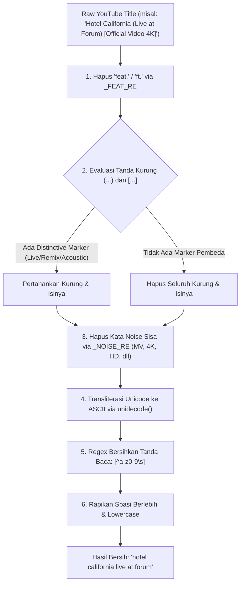
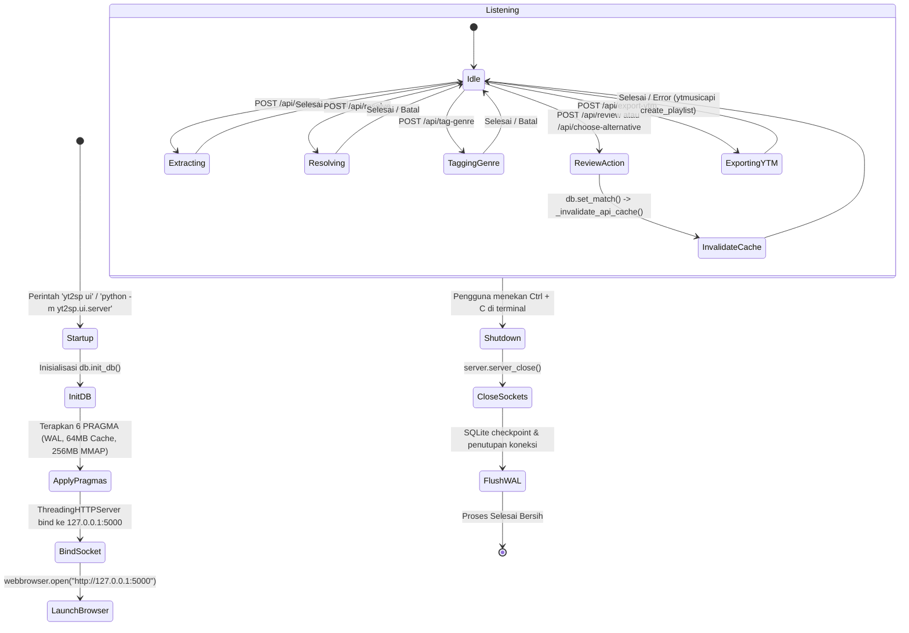

# 06. BUSINESS LOGIC, ALGORITHMS & STATE MANAGEMENT
# YT2Spotify (`yt2sp`) — High-Precision, Zero-Cost Music Migration Platform

---

## 1. Core Algorithms & Mathematical Foundations

### 1.1 Algoritma Pencocokan Fuzzy & Formula Skor (Fuzzy Matching Engine)
Tujuan utama algoritma ini adalah menentukan probabilitas kecocokan antara metadata lagu di YouTube Music dengan kandidat lagu di katalog Spotify.

#### Formula Matematika Skor Kemiripan
Skor dihitung melalui fungsi `compute_score()` di [yt2sp/match/score.py:31-80](file:///C:/Users/Elang/.gemini/antigravity/worktrees/yt-spt/generate_technical_documentation/yt2sp/match/score.py#L31-L80):

$$\text{TitleSim} = \frac{\text{TokenSetRatio}(\text{Norm}(\text{Title}_{\text{YTM}}), \text{Norm}(\text{Title}_{\text{SP}}))}{100.0}$$

$$\text{ArtistSim} = \max_{a \in \text{Artists}_{\text{YTM}}} \left( \frac{\text{TokenSetRatio}(\text{Norm}(a), \text{Norm}(\text{Artist}_{\text{SP}}))}{100.0} \right)$$

$$\text{BaseScore} = (W_{\text{title}} \times \text{TitleSim}) + (W_{\text{artist}} \times \text{ArtistSim})$$

*Default Bobot:* $W_{\text{title}} = 0.65$ dan $W_{\text{artist}} = 0.35$ (berdasarkan `config.toml`).

#### Penalti Penanda Pembeda (Distinctive Marker Penalty)
Jika salah satu pihak mengandung penanda pembeda aransemen (misal: `"live"`, `"acoustic"`, `"remix"`) sementara pihak lain tidak:
$$\text{Score} \leftarrow \text{Score} - 0.12$$
*(Catatan Arsitektur: Nilai penalti diturunkan dari 0.30 menjadi 0.12 pada commit 940a18e untuk mencegah false-negative pada judul rekaman konser yang sah).*

#### Penalti Toleransi Durasi (Duration Penalty)
Jika durasi kedua lagu tersedia dan selisihnya melebihi ambang batas toleransi:
$$\Delta t = |\text{Duration}_{\text{YTM}} - \text{Duration}_{\text{SP}}|$$
$$\text{Jika } \Delta t > 5.000\text{ ms} \text{ DAN } \left( \frac{\Delta t}{\text{Duration}_{\text{YTM}}} > 0.10 \text{ ATAU } \Delta t > 12.000\text{ ms} \right) \implies \text{Score} \leftarrow \text{Score} - 0.10$$

#### Ambang Batas Klasifikasi (Classification Thresholds)
$$\text{Status} = \begin{cases} 
\text{'resolved\_auto'}, & \text{jika } \text{Score} \ge 0.80 \\
\text{'needs\_review'}, & \text{jika } 0.55 \le \text{Score} < 0.80 \\
\text{'failed'}, & \text{jika } \text{Score} < 0.55
\end{cases}$$

*Kompleksitas:*
* **Time Complexity:** $\mathcal{O}(L_1 \times L_2)$ di mana $L_1, L_2$ adalah panjang string karakter judul/artis, dioptimalkan menggunakan C++ SIMD bindings di RapidFuzz.
* **Space Complexity:** $\mathcal{O}(L_1 + L_2)$ untuk alokasi buffer string normalisasi.

---

### 1.2 Algoritma Normalisasi Judul & Pembersihan Noise (Regex Filter)
Diimplementasikan dalam [yt2sp/match/normalize.py](file:///C:/Users/Elang/.gemini/antigravity/worktrees/yt-spt/generate_technical_documentation/yt2sp/match/normalize.py).

#### Alur Eksekusi Pembersihan


---

### 1.3 Algoritma Token Bucket Rate Limiter
Diimplementasikan dalam [yt2sp/resolve/rate_limiter.py](file:///C:/Users/Elang/.gemini/antigravity/worktrees/yt-spt/generate_technical_documentation/yt2sp/resolve/rate_limiter.py).

#### Logika Matematika Token Bucket
* **Kapasitas Maksimum ($C$):** $C = \text{rate\_per\_minute}$ token (misal: 120 token).
* **Laju Pengisian ($R$):** $R = \frac{\text{rate\_per\_minute}}{60.0}$ token per detik.
* **Waktu Berlalu ($\Delta t$):** $\Delta t = t_{\text{sekarang}} - t_{\text{terakhir}}$.
* **Pengisian Token:** $\text{Tokens} = \min(C, \text{Tokens} + \Delta t \times R)$.
* **Eksekusi `acquire()`:**
  ```python
  while True:
      with lock:
          refill()
          if tokens >= 1.0:
              tokens -= 1.0
              return
          wait_seconds = (1.0 - tokens) / rate_per_second
      time.sleep(wait_seconds)
  ```

---

### 1.4 Algoritma Rekonsiliasi & Validasi Silang Genre Multi-Sumber
Diimplementasikan dalam [yt2sp/resolve/genre.py](file:///C:/Users/Elang/.gemini/antigravity/worktrees/yt-spt/generate_technical_documentation/yt2sp/resolve/genre.py).

#### 5 Tingkat Hierarki Rekonsiliasi
1. **Tier 1: Kesepakatan Penuh (`validated_agreement`) — Confidence 1.0**
   - Terjadi jika `itunes_genre == deezer_genre` setelah dipetakan ke `GENRE_GROUPS`.
2. **Tier 2: Resolusi Spesifisitas Subgenre (`cross_validated`) — Confidence 0.92**
   - Jika salah satu sumber melaporkan subgenre spesifik (misal: *Indonesian Pop, Dangdut & Koplo, K-Pop, Anime, R&B/Soul*) sementara sumber lain melaporkan genre umum (*Pop, Rock, Asian Music*), maka **subgenre spesifik yang memenangkan klasifikasi**.
3. **Tier 3: Sumber Tunggal (`single_source_itunes` / `single_source_deezer`) — Confidence 0.85**
   - Hanya salah satu API yang mengembalikan genre lagu tersebut.
4. **Tier 4: Fallback Heuristik Kontekstual (`heuristic`) — Confidence 0.75**
   - Dideteksi via `detect_genre_heuristic()` berdasarkan kata kunci pada judul/artis (misal: *HOYO-MiX $\rightarrow$ Soundtrack & Classical*, *Hatsune Miku $\rightarrow$ Anime*, *Kendang/Adella $\rightarrow$ Dangdut & Koplo*).
5. **Tier 5: Tidak Ditemukan (`uncategorized`) — Confidence 0.0**
   - Genre diberi label `"Uncategorized"`.

---

### 1.5 Algoritma Parser Teks Bebas AI (Smart Group Playlist Builder)
Diimplementasikan pada JavaScript frontend [yt2sp/ui/index.html](file:///C:/Users/Elang/.gemini/antigravity/worktrees/yt-spt/generate_technical_documentation/yt2sp/ui/index.html).

#### Logika Pemecahan & Deteksi Header
1. **Deteksi Header Kategori:**
   - Baris diawali dengan pola Markdown (`#`, `##`, `###`), tanda bintang `**...**`, atau format `[Kategori]`.
   - Mengabaikan angka nomor urut (`1.`, `2.`) agar tidak salah dideteksi sebagai header grup.
2. **Deteksi Judul & Artis Dua Arah (Dash Split):**
   - Mendukung format `Judul — Artis` maupun sebaliknya `Artis — Judul`.
   - Menggunakan pemisah standar yang aman: `—` (em-dash), `–` (en-dash), `-` (hyphen), dan `|` (pipe).
   - Simbol tanda baca titik ganda, koma, titik dua (seperti pada judul jam `1:15 AM`) dilindungi agar tidak terpotong.
3. **Pencocokan Lagu Cerdas Multibahasa:**
   - Mempertahankan karakter Unicode huruf dan angka (`\p{L}\p{N}`) sehingga judul berbahasa Jepang, Korea, dan Mandarin tidak terhapus menjadi string kosong.
   - Evaluasi panjang karakter minimum (`_strMatch`) untuk mencegah kecocokan semu (*false-positive substring collapse*).

---

## 2. State & Event Management Architecture

### 2.1 Backend Server-Side State
Dikelola di [yt2sp/ui/server.py](file:///C:/Users/Elang/.gemini/antigravity/worktrees/yt-spt/generate_technical_documentation/yt2sp/ui/server.py):

| Variabel State | Tipe Data & Mekanisme Kunci | Tanggung Jawab & Sinkronisasi |
| :--- | :--- | :--- |
| `_job_state` | `dict[str, Any]` dilindungi `threading.Lock()` | Menyimpan status pekerjaan aktif (`running`, `type`, `current`, `total`, `message`, `error`). |
| `_job_cancel_event` | `threading.Event()` | Sinyal interupsi thread; diatur melalui `POST /api/cancel`. |
| `_api_cache_store` | `dict[str, tuple[float, Any]]` dilindungi `_api_cache_lock` | In-memory cache dengan TTL untuk respon `/api/status`, `/api/playlists`, `/api/tracks`, `/api/uris`. Dikosongkan instan via `_invalidate_api_cache()` saat ada mutasi data. |
| `_local.conn` | `threading.local()` | Objek koneksi basis data SQLite terisolasi per thread eksekusi. |

### 2.2 Frontend Client-Side State
Dikelola pada window scope di [yt2sp/ui/index.html](file:///C:/Users/Elang/.gemini/antigravity/worktrees/yt-spt/generate_technical_documentation/yt2sp/ui/index.html):

```javascript
let _playlists = [];              // Cache array seluruh playlist
let _tracks = [];                 // Cache array lagu yang sedang ditampilkan
let _currentView = 'overview';    // Tampilan aktif ('overview', 'playlists', 'transfer', dll)
let _activePlaylistId = 'all';    // Filter ID playlist saat ini
let _statusFilter = '';           // Filter status matching ('', 'resolved_auto', 'needs_review')
let _genreFilter = '';            // Filter genre aktif
let _searchQuery = '';            // Kueri pencarian teks bebas
let _currentPage = 1;             // Halaman paginasi aktif
let _selectionMode = false;       // Status mode multi-seleksi
let _selectedTrackIds = new Set();// Set video_id yang dipilih pengguna
let _pollTimer = null;            // Handle timer polling adaptif
let _isPerfMode = false;          // Status Low-Spec Potato Mode
```

### 2.3 Siklus Polling Adaptif (`scheduleNextPoll`)
Untuk menghemat penggunaan CPU lokal namun tetap menyajikan pembaruan instan:
* **Saat Background Job Aktif (`job.running == true`):** Polling dijalankan setiap **1.5 detik** (`1500ms`).
* **Saat Server Diam (*Idle*):** Polling melambat secara otomatis menjadi setiap **6.0 detik** (`6000ms`).

---

## 3. Application Execution Lifecycle

Perjalanan siklus hidup eksekusi sistem dari inisialisasi hingga shutdown:



---

## 4. Chunked YouTube Music Playlist Ingestion Algorithm
Diimplementasikan dalam [yt2sp/destinations/ytm_writer.py](file:///C:/Users/Elang/.gemini/antigravity/worktrees/yt-spt/generate_technical_documentation/yt2sp/destinations/ytm_writer.py).

### 4.1 Logika Pembuatan & Injeksi Lagu
Untuk memastikan pengisian playlist berjalan stabil tanpa terputus limit request YouTube Music:
1. **Deduplikasi Memori:** Mempertahankan urutan lagu asli namun mendeteksi dan menghapus duplikasi video ID sebelum dikirim ke API.
2. **Chunking 50 Lagu:** Mengelompokkan video IDs ke dalam batch berukuran $\le 50$ item per panggilan `add_playlist_items(playlist_id, chunk_vids, duplicates=True)`.
3. **Resilience & Fallback:** Jika sebuah batch mengalami partial error, sistem mencatat kegagalan per item tanpa menggugurkan keseluruhan proses playlist yang telah dibuat.
