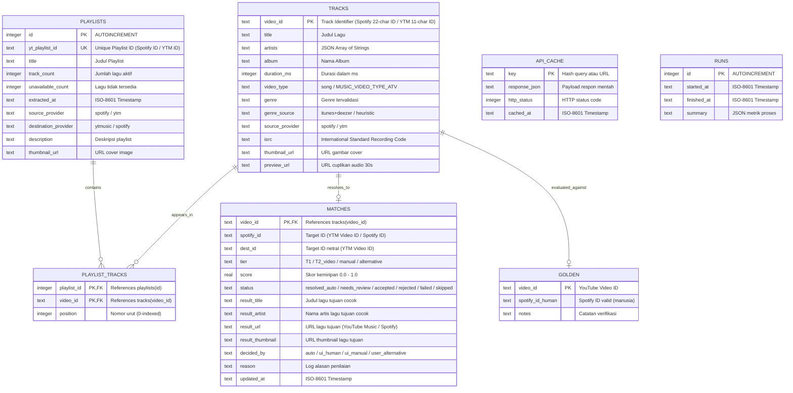

# 07. DATABASE & API SPECIFICATION
# YT2Spotify (`yt2sp`) — High-Precision, Zero-Cost Music Migration Platform

---

## 1. Database Specification (SQLite 3 WAL)

### 1.1 Skema Konseptual & Entity-Relationship Diagram (ERD)



---

### 1.2 Data Definition Language (DDL) & Indeks Performa

Diverifikasi langsung dari [yt2sp/store/db.py:36-119](file:///C:/Users/Elang/.gemini/antigravity/worktrees/yt-spt/generate_technical_documentation/yt2sp/store/db.py#L36-L119):

```sql
-- 1. Tabel playlists
CREATE TABLE IF NOT EXISTS playlists (
    id                INTEGER PRIMARY KEY AUTOINCREMENT,
    yt_playlist_id    TEXT UNIQUE NOT NULL,
    title             TEXT,
    track_count       INTEGER,
    unavailable_count INTEGER DEFAULT 0,
    extracted_at      TEXT
);

-- 2. Tabel tracks
CREATE TABLE IF NOT EXISTS tracks (
    video_id     TEXT PRIMARY KEY,
    title        TEXT,
    artists      TEXT,   -- JSON array of strings: '["Artist 1", "Artist 2"]'
    album        TEXT,
    duration_ms  INTEGER,
    video_type   TEXT,
    genre        TEXT,
    genre_source TEXT
);

-- 3. Tabel playlist_tracks (Relasi Many-to-Many)
CREATE TABLE IF NOT EXISTS playlist_tracks (
    playlist_id INTEGER NOT NULL REFERENCES playlists(id),
    video_id    TEXT    NOT NULL REFERENCES tracks(video_id),
    position    INTEGER NOT NULL,
    PRIMARY KEY (playlist_id, video_id)
);

-- 4. Tabel matches
CREATE TABLE IF NOT EXISTS matches (
    video_id        TEXT PRIMARY KEY REFERENCES tracks(video_id),
    spotify_id      TEXT,
    tier            TEXT,
    score           REAL,
    status          TEXT DEFAULT 'pending',
    result_title    TEXT,
    result_artist   TEXT,
    decided_by      TEXT,
    reason          TEXT,
    updated_at      TEXT
);

-- 5. Tabel api_cache
CREATE TABLE IF NOT EXISTS api_cache (
    key           TEXT PRIMARY KEY,
    response_json TEXT,
    http_status   INTEGER,
    cached_at     TEXT
);

-- 6. Tabel runs
CREATE TABLE IF NOT EXISTS runs (
    id          INTEGER PRIMARY KEY AUTOINCREMENT,
    started_at  TEXT,
    finished_at TEXT,
    summary     TEXT
);

-- 7. Tabel golden
CREATE TABLE IF NOT EXISTS golden (
    video_id         TEXT PRIMARY KEY,
    spotify_id_human TEXT,
    notes            TEXT
);

-- Indeks Performa Tinggi
CREATE INDEX IF NOT EXISTS idx_matches_status ON matches(status);
CREATE INDEX IF NOT EXISTS idx_matches_status_spid ON matches(status, spotify_id);
CREATE INDEX IF NOT EXISTS idx_matches_spid ON matches(spotify_id);
CREATE INDEX IF NOT EXISTS idx_pt_playlist ON playlist_tracks(playlist_id);
CREATE INDEX IF NOT EXISTS idx_pt_video ON playlist_tracks(video_id);
CREATE INDEX IF NOT EXISTS idx_tracks_genre ON tracks(genre);
CREATE INDEX IF NOT EXISTS idx_api_cache_key ON api_cache(key);
```

---

## 2. Comprehensive REST API Specification

Seluruh endpoint diimplementasikan dalam [yt2sp/ui/server.py](file:///C:/Users/Elang/.gemini/antigravity/worktrees/yt-spt/generate_technical_documentation/yt2sp/ui/server.py).

---

### 2.1 `GET /api/version`
* **Tujuan:** Mengambil versi dinamis dan penanda arsitektur mesin sistem.
* **Headers:** `Accept: application/json`
* **Status Code:** `200 OK`
* **Response Body:**
```json
{
  "version": "1.3.7",
  "engine": "Multi-Pass"
}
```

---

### 2.2 `GET /api/status`
* **Tujuan:** Mengambil statistik kesehatan pustaka lokal dan status pekerjaan background.
* **Caching:** In-memory TTL 1.0 detik.
* **Status Code:** `200 OK`
* **Response Body:**
```json
{
  "total": 150,
  "pending": 0,
  "resolved_auto": 138,
  "needs_review": 8,
  "accepted": 3,
  "rejected": 1,
  "failed": 0,
  "skipped": 0,
  "version": "1.3.7",
  "version_badge": "v1.3.7",
  "job": {
    "running": false,
    "type": null,
    "current": 150,
    "total": 150,
    "message": "Pencocokan selesai!",
    "error": null
  }
}
```

---

### 2.3 `GET /api/playlists`
* **Tujuan:** Mengambil daftar semua playlist, breakdown genre, jumlah video tidak tersedia, dan 4 sampling video ID untuk 2x2 collage artwork.
* **Caching:** In-memory TTL 2.0 detik.
* **Status Code:** `200 OK`
* **Response Body:**
```json
{
  "playlists": [
    {
      "id": 1,
      "yt_playlist_id": "PLrAlnrLmm5Vw...",
      "title": "Indie Folk & Chill",
      "track_count": 50,
      "unavailable_count": 2,
      "extracted_at": "2026-11-14T10:00:00+00:00",
      "genres": [
        {"genre": "Alternative & Indie", "count": 32},
        {"genre": "Acoustic & Folk", "count": 18}
      ],
      "sample_video_ids": ["vid1", "vid2", "vid3", "vid4"]
    }
  ],
  "library": {
    "total_tracks": 50,
    "genres": [
      {"genre": "Alternative & Indie", "count": 32}
    ]
  }
}
```

---

### 2.4 `GET /api/tracks`
* **Tujuan:** Mengambil daftar lagu dengan dukungan filter playlist, genre, status, dan pencarian teks bebas.
* **Query Parameters:**
  - `playlist_id` (string, opsional): ID playlist numerik atau `"all"`.
  - `genre` (string, opsional): Filter nama genre.
  - `status` (string, opsional): Filter status (`"resolved_auto"`, `"needs_review"`, `"accepted"`, dll).
  - `q` (string, opsional): Kueri teks bebas pada judul, musisi, album, atau genre.
* **Status Code:** `200 OK`
* **Response Body:**
```json
{
  "tracks": [
    {
      "video_id": "dQw4w9WgXcQ",
      "title": "Never Gonna Give You Up",
      "ascii_title": "never gonna give you up",
      "artists": ["Rick Astley"],
      "album": "Whenever You Need Somebody",
      "duration_s": 213,
      "genre": "Pop",
      "status": "resolved_auto",
      "score": 0.985,
      "spotify_id": "4cOdK2wGLETKBW3PvgPWqT",
      "reason": "ok",
      "result_title": "Never Gonna Give You Up",
      "ascii_result": "never gonna give you up",
      "result_artist": "Rick Astley",
      "genre_source": "itunes+deezer",
      "in_playlists": "Indie Folk & Chill"
    }
  ],
  "total": 1
}
```

---

### 2.5 `GET /api/uris`
* **Tujuan:** Mengambil daftar Spotify URIs yang disetujui, dibagi ke dalam chunk 50 lagu siap salin.
* **Query Parameters:**
  - `playlist_id` (opsional): Filter ID playlist.
  - `genre` (opsional): Filter genre.
  - `chunk_size` (integer, default: 50): Ukuran blok lagu per chunk.
* **Status Code:** `200 OK`
* **Response Body:**
```json
{
  "total": 52,
  "uris": [
    "spotify:track:4cOdK2wGLETKBW3PvgPWqT"
  ],
  "chunks": [
    {
      "part": 1,
      "count": 50,
      "uris": ["spotify:track:..."],
      "text": "spotify:track:...\nspotify:track:..."
    },
    {
      "part": 2,
      "count": 2,
      "uris": ["spotify:track:..."],
      "text": "spotify:track:...\nspotify:track:..."
    }
  ]
}
```

---

### 2.6 `GET /api/preview`
* **Tujuan:** Mengambil URL streaming pratinjau audio 30 detik (reff) via Deezer CDN $\rightarrow$ iTunes fallback.
* **Query Parameters:** `video_id`, `q`, `spotify_id`, `title`, `artist`.
* **Caching:** In-memory TTL 24 jam (`86400.0` detik).
* **Status Code:** `200 OK`
* **Response Body:**
```json
{
  "preview_url": "https://cdns-preview-d.dzcdn.net/stream/c-...",
  "title": "Never Gonna Give You Up",
  "artist": "Rick Astley",
  "provider": "deezer",
  "duration": 30
}
```

---

### 2.7 `GET /api/alternatives`
* **Tujuan:** Mencari hingga 8 variasi versi lagu di Spotify (Cover, Acoustic, Live, Remix).
* **Query Parameters:** `video_id` (string, wajib).
* **Status Code:** `200 OK`
* **Response Body:**
```json
{
  "video_id": "dQw4w9WgXcQ",
  "title": "Never Gonna Give You Up",
  "artists": ["Rick Astley"],
  "alternatives": [
    {
      "spotify_id": "5nvd4nFxxxx",
      "uri": "spotify:track:5nvd4nFxxxx",
      "title": "Never Gonna Give You Up (Acoustic)",
      "artist": "Rick Astley",
      "duration_s": 205,
      "tag": "Versi Alternatif (Cover/Remix/Live)",
      "badge_color": "purple",
      "desc": "Versi aransemen lain oleh Rick Astley",
      "title_sim": 85,
      "art_sim": 100
    }
  ]
}
```

---

### 2.8 `POST /api/extract`
* **Tujuan:** Memulai thread penarikan daftar lagu dari YouTube Music.
* **Headers:** `Content-Type: application/json`
* **Request Body:**
```json
{
  "playlist_id": "https://music.youtube.com/playlist?list=PLrAlnrLmm5Vw...",
  "liked": false
}
```
* **Status Code:** `200 OK`
* **Response Body:** `{"status": "started"}`
* **Error Response (400):** `{"error": "Proses lain sedang berjalan"}`

---

### 2.9 `POST /api/resolve`
* **Tujuan:** Memulai thread pencocokan katalog lagu pending ke Spotify.
* **Headers:** `Content-Type: application/json`
* **Request Body:**
```json
{
  "playlist_id": "all",
  "force": false
}
```
* **Status Code:** `200 OK`
* **Response Body:** `{"status": "started"}`

---

### 2.10 `POST /api/cancel`
* **Tujuan:** Menghentikan seketika proses penarikan atau pencocokan background yang sedang berjalan.
* **Headers:** `Content-Type: application/json`
* **Request Body:** `{}`
* **Status Code:** `200 OK`
* **Response Body:**
```json
{
  "status": "cancelled",
  "was_running": true
}
```

---

### 2.11 `POST /api/review`
* **Tujuan:** Menetapkan keputusan manual pada lagu yang meragukan.
* **Format 1: Accept / Reject**
```json
{
  "video_id": "dQw4w9WgXcQ",
  "action": "accept"
}
```
* **Format 2: Manual Spotify URL / URI Linking**
```json
{
  "video_id": "dQw4w9WgXcQ",
  "action": "manual",
  "spotify_id": "https://open.spotify.com/track/4cOdK2wGLETKBW3PvgPWqT"
}
```
* **Status Code:** `200 OK`
* **Response Body (Manual Linking):**
```json
{
  "status": "ok",
  "spotify_id": "4cOdK2wGLETKBW3PvgPWqT",
  "title": "Never Gonna Give You Up",
  "thumbnail_url": "https://i.scdn.co/image/ab67616d0000b273..."
}
```

---

### 2.12 `POST /api/create-grouped-playlist`
* **Tujuan:** Membuat playlist kustom di basis data lokal berdasarkan hasil parsing AI Group Splitter Studio.
* **Request Body:**
```json
{
  "groups": [
    {
      "title": "Japanese Chill & City Pop",
      "video_ids": ["vid1", "vid2", "vid3"]
    }
  ]
}
```
* **Status Code:** `200 OK`
* **Response Body:**
```json
{
  "status": "ok",
  "created": [
    {
      "id": 2,
      "title": "Japanese Chill & City Pop",
      "track_count": 3
    }
  ]
}
```

---

### 2.13 `POST /api/export-ytm`
* **Tujuan:** Membuat playlist baru di akun YouTube Music pengguna dan memasukkan seluruh lagu yang telah disetujui (`status IN ('accepted', 'resolved_auto')`) ke dalam playlist tersebut.
* **Request Body:**
```json
{
  "playlist_id": "all",
  "title": "Koleksi Favorit (Spotify2YTM)",
  "privacy": "PRIVATE"
}
```
* **Status Code:** `200 OK` (atau `401 Unauthorized` jika file autentikasi `ytm_auth.json` belum dikonfigurasi).
* **Response Body:**
```json
{
  "status": "ok",
  "playlist_id": "PLabc123xyz...",
  "playlist_url": "https://music.youtube.com/playlist?list=PLabc123xyz...",
  "total_added": 48,
  "total_requested": 50,
  "failed_count": 2,
  "title": "Koleksi Favorit (Spotify2YTM)"
}
```

---

### 2.14 `GET /api/ytm-auth-status`
* **Tujuan:** Memeriksa apakah berkas autentikasi YouTube Music (`ytm_auth.json`) valid dan akun pengguna terhubung untuk penulisan playlist.
* **Status Code:** `200 OK`
* **Response Body:**
```json
{
  "authenticated": true,
  "error": null,
  "auth_file": "ytm_auth.json"
}
```

---

### 2.15 `POST /api/save-ytm-auth`
* **Tujuan:** Menyimpan header request browser cURL untuk menginisialisasi atau memperbarui berkas `ytm_auth.json`.
* **Request Body:**
```json
{
  "headers": "curl 'https://music.youtube.com' -H 'Cookie: ...' -H 'Authorization: ...'"
}
```
* **Status Code:** `200 OK`
* **Response Body:**
```json
{
  "status": "ok",
  "message": "Autentikasi YouTube Music berhasil disimpan!"
}
```
