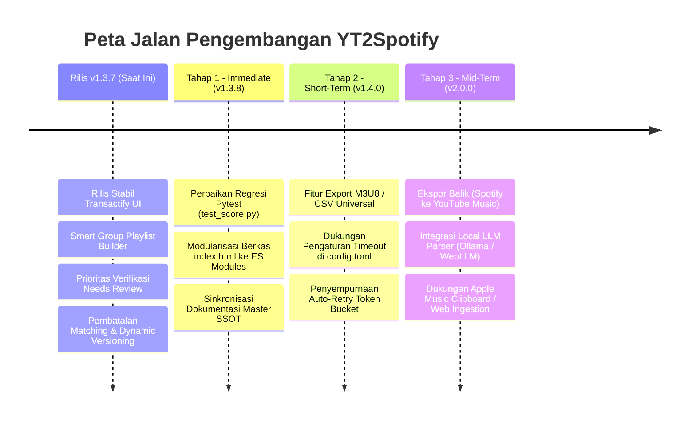

# 10. KNOWN ISSUES, TECHNICAL DEBT & PRODUCT ROADMAP
# YT2Spotify (`yt2sp`) — High-Precision, Zero-Cost Music Migration Platform

---

## 1. Implementation Status Matrix

Tabel berikut menyajikan status implementasi seluruh kapabilitas perangkat lunak berdasarkan bukti aktual di dalam kode sumber repositori:

| Nama Fitur / Modul | Status Implementasi | Bukti Kode Sumber | Pekerjaan Tersisa / Catatan |
| :--- | :--- | :--- | :--- |
| **Ekstraksi Playlist Publik & Unlisted** | `[IMPLEMENTED]` | [yt2sp/ytm/extract.py:68](file:///C:/Users/Elang/.gemini/antigravity/worktrees/yt-spt/generate_technical_documentation/yt2sp/ytm/extract.py#L68) | Stabil, menangani pagination otomatis. |
| **Penghitungan Video YouTube Terhapus** | `[IMPLEMENTED]` | [yt2sp/ytm/extract.py:83](file:///C:/Users/Elang/.gemini/antigravity/worktrees/yt-spt/generate_technical_documentation/yt2sp/ytm/extract.py#L83) | Menghitung `unavailable_count = max(0, reported - len)`. |
| **Ekstraksi Liked Music Akun Pribadi** | `[IMPLEMENTED]` | [yt2sp/ytm/extract.py:131](file:///C:/Users/Elang/.gemini/antigravity/worktrees/yt-spt/generate_technical_documentation/yt2sp/ytm/extract.py#L131) | Membutuhkan file `ytm_auth.json` (disediakan CLI panduan). |
| **Normalisasi Judul & Regex Noise** | `[IMPLEMENTED]` | [yt2sp/match/normalize.py:62](file:///C:/Users/Elang/.gemini/antigravity/worktrees/yt-spt/generate_technical_documentation/yt2sp/match/normalize.py#L62) | Memfilter 17 pola noise video YouTube. |
| **Perlindungan Penanda Pembeda (Markers)** | `[IMPLEMENTED]` | [yt2sp/match/normalize.py:18](file:///C:/Users/Elang/.gemini/antigravity/worktrees/yt-spt/generate_technical_documentation/yt2sp/match/normalize.py#L18) | Melindungi 15 penanda pembeda aransemen. |
| **Pencarian Spotify Web Publik (T1)** | `[IMPLEMENTED]` | [yt2sp/resolve/spotify_resolver.py:47](file:///C:/Users/Elang/.gemini/antigravity/worktrees/yt-spt/generate_technical_documentation/yt2sp/resolve/spotify_resolver.py#L47) | Menggunakan `spotifyscraper` tanpa token dev. |
| **ISRC Bridge Fallback (T2)** | `[IMPLEMENTED]` | [yt2sp/resolve/deezer_resolver.py:47](file:///C:/Users/Elang/.gemini/antigravity/worktrees/yt-spt/generate_technical_documentation/yt2sp/resolve/deezer_resolver.py#L47) | Deezer ISRC $\rightarrow$ MusicBrainz $\rightarrow$ Spotify ID. |
| **Pembatalan Proses Matching** | `[IMPLEMENTED]` | [yt2sp/resolve/pipeline.py:47](file:///C:/Users/Elang/.gemini/antigravity/worktrees/yt-spt/generate_technical_documentation/yt2sp/resolve/pipeline.py#L47) | Mendukung `stop_event` dan endpoint `POST /api/cancel`. |
| **Pratinjau Audio 30 Detik (Hover)** | `[IMPLEMENTED]` | [yt2sp/ui/server.py:73-100](file:///C:/Users/Elang/.gemini/antigravity/worktrees/yt-spt/generate_technical_documentation/yt2sp/ui/server.py#L73-L100) | Deezer MP3 $\rightarrow$ Apple iTunes AAC fallback. |
| **Validasi Silang Genre Multi-Sumber** | `[IMPLEMENTED]` | [yt2sp/resolve/genre.py:219](file:///C:/Users/Elang/.gemini/antigravity/worktrees/yt-spt/generate_technical_documentation/yt2sp/resolve/genre.py#L219) | Konsensus paralel iTunes + Deezer + Heuristik. |
| **Smart Group Playlist Builder (AI)** | `[IMPLEMENTED]` | [yt2sp/ui/index.html:6200](file:///C:/Users/Elang/.gemini/antigravity/worktrees/yt-spt/generate_technical_documentation/yt2sp/ui/index.html) | Parser teks AI bebas format & direct Spotify link. |
| **Prioritas Verifikasi di Needs Review**| `[IMPLEMENTED]` | [yt2sp/ui/index.html:4300](file:///C:/Users/Elang/.gemini/antigravity/worktrees/yt-spt/generate_technical_documentation/yt2sp/ui/index.html) | Pin baris amber menyala untuk lagu belum diverifikasi. |
| **2x2 Dynamic Collage Artwork** | `[IMPLEMENTED]` | [yt2sp/store/db.py:159](file:///C:/Users/Elang/.gemini/antigravity/worktrees/yt-spt/generate_technical_documentation/yt2sp/store/db.py#L159) & UI | Mengambil 4 video ID teratas untuk dirender ke grid 2x2. |
| **Low-Spec Potato Mode** | `[IMPLEMENTED]` | [yt2sp/ui/index.html:3600](file:///C:/Users/Elang/.gemini/antigravity/worktrees/yt-spt/generate_technical_documentation/yt2sp/ui/index.html) | Menonaktifkan blur, shadow, dan canvas GPU. |
| **Unit Test Suite (Pytest)** | `[TECHNICAL DEBT]` | [tests/test_score.py:28, 35](file:///C:/Users/Elang/.gemini/antigravity/worktrees/yt-spt/generate_technical_documentation/tests/test_score.py#L28) | 19 Passed, 2 Failed karena perubahan threshold. |
| **Sinkronisasi Dua Arah (Spotify $\rightarrow$ YTM)**| `[NOT IMPLEMENTED]` | Tidak ada kode sumber | Masuk dalam roadmap jangka panjang. |

---

## 2. Identified Technical Debt & Code Smells

### 2.1 Regresi Kasus Uji `test_score.py` (Prioritas: CRITICAL)
* **Kategori:** Test Inconsistency / Out-of-Sync Specifications.
* **Deskripsi:** Perubahan logika scoring di commit `940a18e` (penurunan penalti pembeda dari `0.30` ke `0.12` dan penurunan ambang batas `auto_accept_threshold` dari `0.85` ke `0.80`) tidak diimbangi dengan pembaruan asersi di `tests/test_score.py`.
* **Dampak:** Pytest melaporkan 2 kegagalan (`assert 0.88 < 0.85` dan `assert 'resolved_auto' == 'needs_review'`).
* **Rencana Perbaikan:** Perbarui asersi pada `test_score.py` agar mencerminkan parameter bisnis terbaru atau sediakan parameter eksplisit pada panggilan pengujian.

### 2.2 Ukuran Berkas Monolitik `yt2sp/ui/index.html` (Prioritas: MEDIUM)
* **Kategori:** Code Maintainability.
* **Deskripsi:** Berkas `index.html` memiliki panjang lebih dari **7.400 baris**, menggabungkan markup HTML, styling Tailwind kustom, template modal, dan ribuan baris logika Vanilla JavaScript dalam satu berkas.
* **Dampak:** Pemeliharaan antarmuka menjadi sulit dan berisiko memicu error sintaksis (seperti yang sempat terjadi pada commit `1991980`).
* **Rencana Perbaikan:** Memecah logika JavaScript ke dalam modul terpisah (misal: `app.js`, `player.js`, `builder.js`, `views.js`) tanpa perlu menambahkan bundler build step berat.

### 2.3 Hardcoded Timeout pada Panggilan Eksternal (Prioritas: LOW)
* **Kategori:** Reliability & Configuration.
* **Deskripsi:** Panggilan jaringan ke iTunes (`timeout=4`), Deezer (`timeout=4`), dan MusicBrainz (`timeout=4`) diatur secara hardcoded di dalam fungsi Python alih-alih dibaca dari `config.toml`.
* **Rencana Perbaikan:** Pindahkan seluruh nilai batas waktu jaringan (*network timeouts*) ke berkas `config.toml`.

---

## 3. Product Improvement Opportunities

Tabel peluang peningkatan sistem diklasifikasikan berdasarkan tingkat prioritas:

| Peluang Peningkatan | Kategori | Prioritas | Estimasi Manfaat |
| :--- | :--- | :--- | :--- |
| **Penyelarasan Asersi `test_score.py`** | Quality Assurance | **CRITICAL** | Mengembalikan status uji otomatis ke status hijau 100% (21/21 Passed). |
| **Modularisasi JavaScript UI** | Architecture | **HIGH** | Memecah 7.400 baris `index.html` menjadi script ES modules terpisah yang lebih aman diedit. |
| **Dukungan Proxy / Custom User-Agent** | Reliability | **MEDIUM** | Mengatasi kemungkinan blokir IP sementara pada koneksi internet publik/kantor. |
| **Dukungan Export ke Format M3U8 / JSON** | Feature | **MEDIUM** | Memungkinkan pengguna mengekspor daftar pustaka ke pemutar media lokal seperti VLC atau Foobar2000. |
| **Konfigurasi Timeout Dinamis di TOML** | Code Quality | **LOW** | Memberikan fleksibilitas bagi pengguna dengan koneksi internet berlatensi tinggi. |

---

## 4. Phased Product Roadmap

### 4.1 Tahap 1: Immediate Enhancements (Patch v1.3.8)
* **Penyelarasan Kasus Uji Otomatis:** Memperbarui `tests/test_score.py` agar menguji ambang batas klasifikasi `0.80` dan penalti `0.12`.
* **Refactoring Script UI:** Memisahkan kode JavaScript dari `index.html` ke berkas terpisah dalam folder `yt2sp/ui/js/` untuk mencegah konflik sintaksis di masa depan.

### 4.2 Tahap 2: Short-Term Enhancements (Minor v1.4.0)
* **Pilihan Format Ekspor Universal:** Menambahkan opsi download format playlist standar industri `.m3u8` dan `.json` agar lagu hasil kurasi dapat dibuka di pemutar musik lokal non-Spotify.
* **Konfigurasi Tingkat Lanjut:** Mengekspos konfigurasi timeout jaringan dan batas kandidat pencarian (`top_n`) ke dalam `config.toml`.

### 4.3 Tahap 3: Mid-Term & Long-Term Roadmap (Major v2.0.0)
* **Reverse Migration Pipeline:** Membangun alur sebaliknya: membaca playlist Spotify publik dan membuat playlist baru di YouTube Music (menggunakan OAuth/Browser session).
* **Integrasi AI Lokal (On-Device LLM):** Mengintegrasikan parser AI langsung di browser menggunakan WebLLM atau API lokal (Ollama), sehingga pengguna tidak perlu lagi membuka tab ChatGPT/Claude secara manual.
